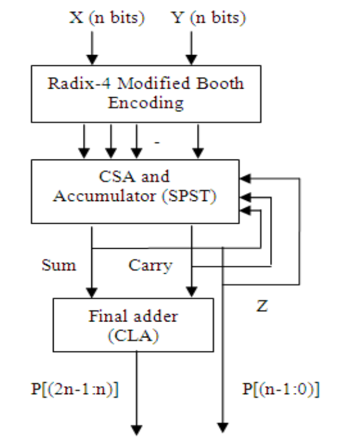
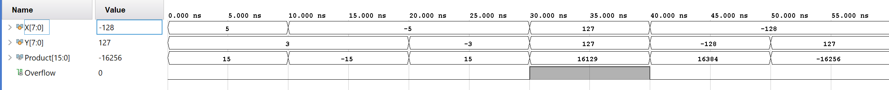
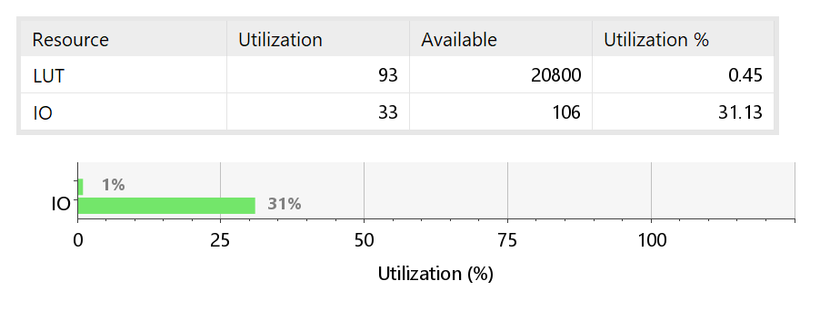
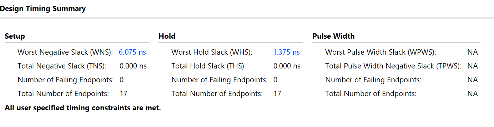
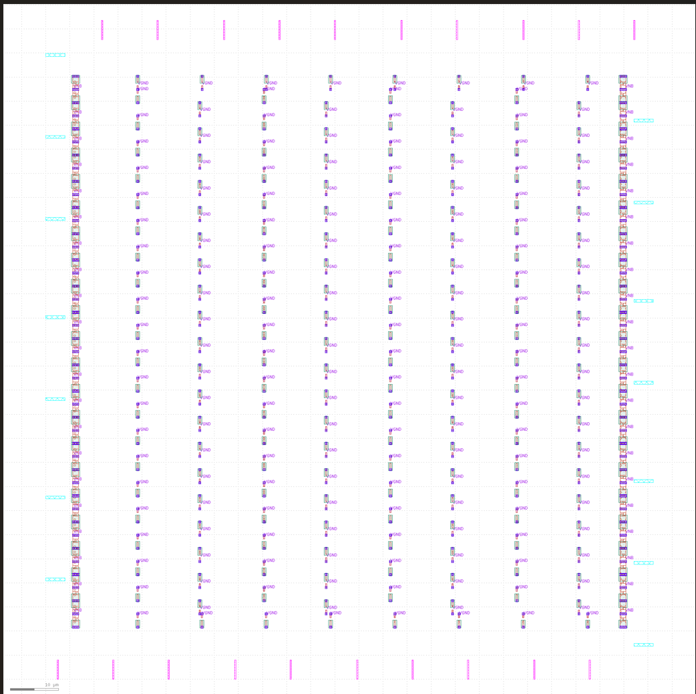
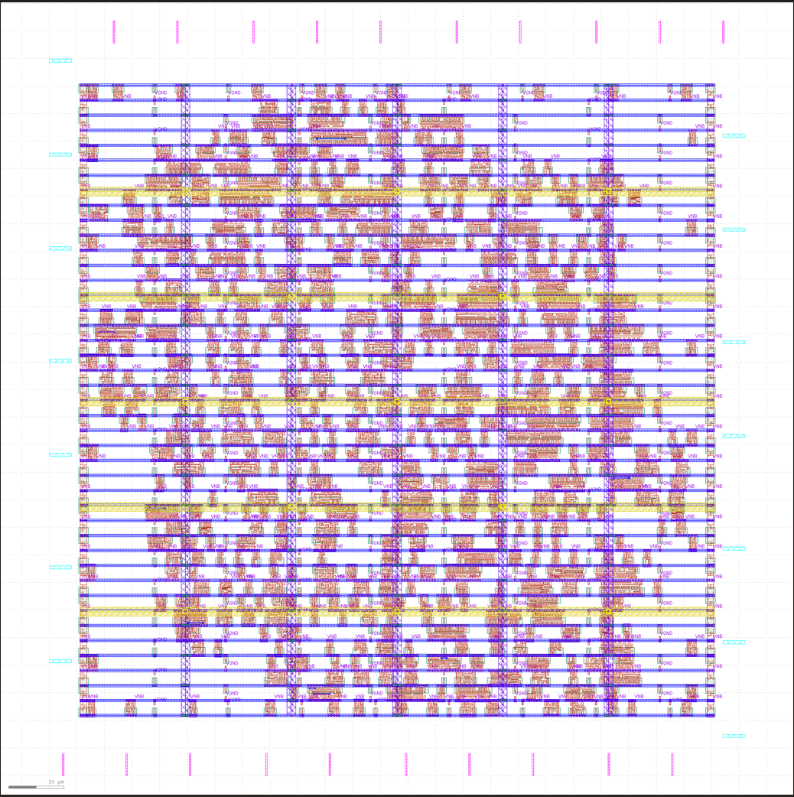
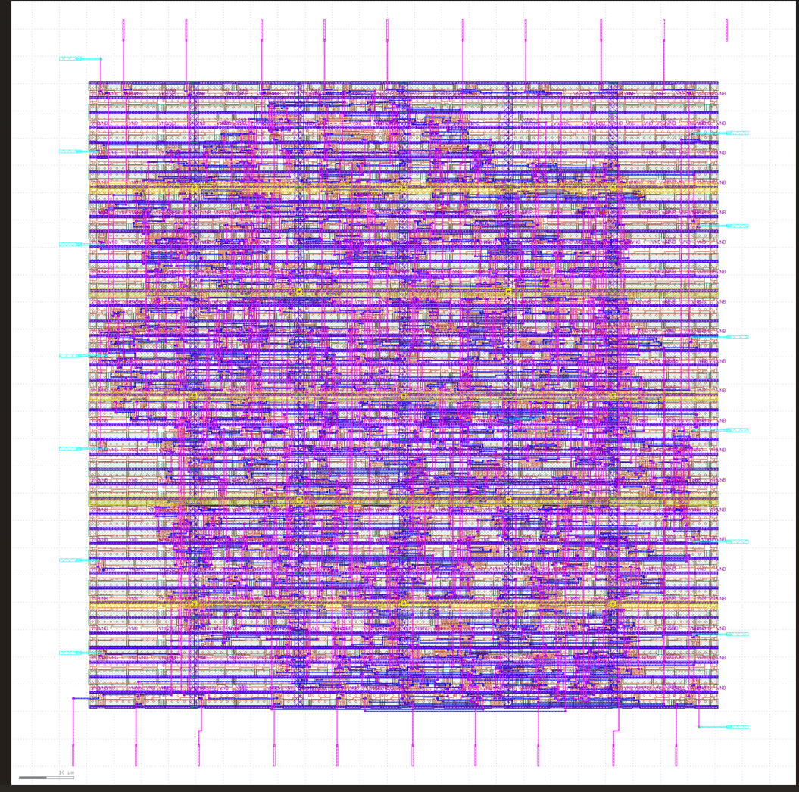
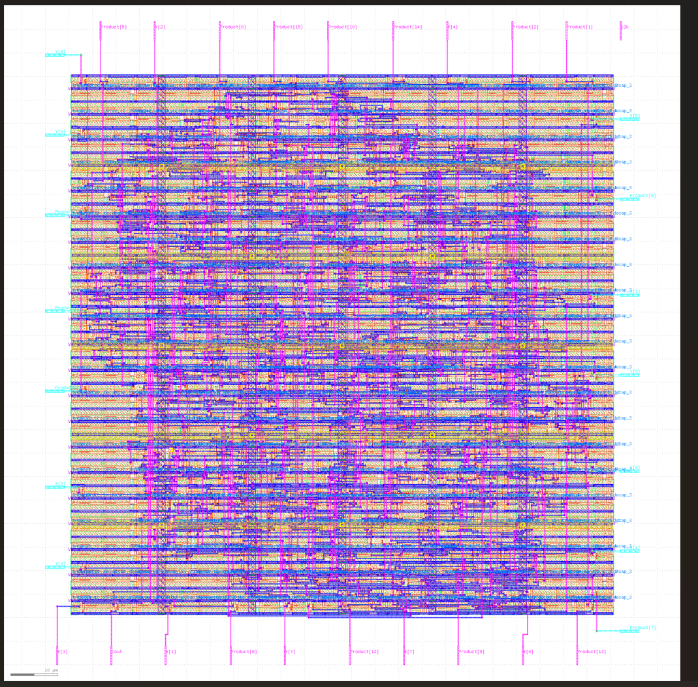
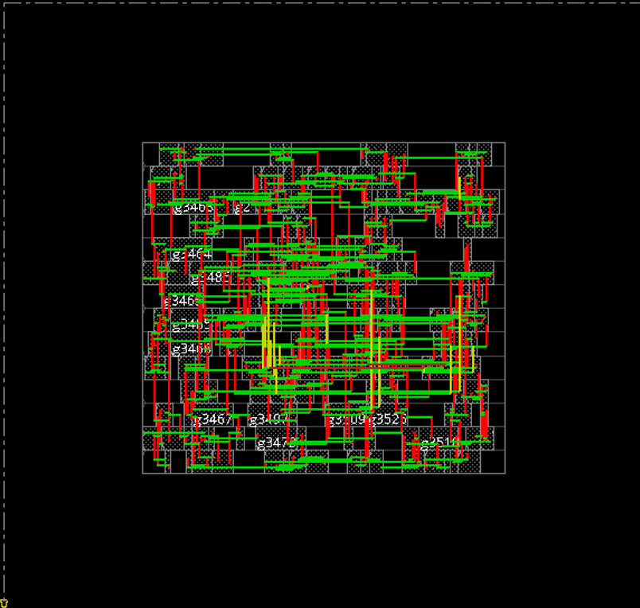

<div align="center">

# Radix-4 Modified Booth Multiplier with 16-bit Carry Lookahead Adder

### High-Speed Signed Multiplier • Verilog HDL • FPGA & ASIC Implementation


Design • Verification • FPGA Synthesis • RTL-to-GDSII

</div>

---

# 📖 Overview

This project presents the design and implementation of an **8-bit signed Radix-4 Modified Booth Multiplier** integrated with a **16-bit Carry Lookahead Adder (CLA)**.

The design reduces multiplication latency by minimizing the number of generated partial products using **Modified Booth Encoding**, compresses them through **Carry Save Adders (CSA)**, and performs the final addition using a **Carry Lookahead Adder (CLA)**.

The complete design was:

- Developed in **Verilog HDL**
- Functionally verified in **Vivado**
- Synthesized and analyzed on FPGA
- Implemented through the complete **RTL-to-GDSII** flow using **OpenLane (Sky130)**
- Re-implemented using **Cadence Genus & Innovus (45nm)** for comparison

---

# 🎯 Highlights

- ✅ 8-bit Signed Radix-4 Booth Multiplier
- ✅ 16-bit Carry Lookahead Adder
- ✅ Modular RTL Design
- ✅ Functional Verification using Verilog Testbench
- ✅ FPGA Synthesis using Vivado
- ✅ Timing & Power Analysis
- ✅ Complete RTL → GDSII Flow using OpenLane
- ✅ Cadence Genus & Innovus Implementation

---

# 🏗 Architecture

<p align="center">

</p>

The architecture consists of the following stages:

1. Booth Encoder
2. Partial Product Generator
3. Carry Save Adder Stage-1
4. Carry Save Adder Stage-2
5. 16-bit Carry Lookahead Adder

---

# 🧩 RTL Modules

| Module | Description |
|---------|-------------|
| `booth_4.v` | Radix-4 Modified Booth Encoder |
| `ppg.v` | Partial Product Generator |
| `csa.v` | Carry Save Adder |
| `cla_16.v` | 16-bit Carry Lookahead Adder |
| `Booth_CLA_Top.v` | Top-Level Integration Module |

---

# 🧪 Functional Verification

The multiplier was verified using a comprehensive Verilog testbench in Vivado.

### Sample Test Cases

| X | Y | Product |
|---:|---:|--------:|
| 5 | 3 | 15 |
| -5 | 3 | -15 |
| 127 | 127 | 16129 |
| -128 | -128 | 16384 |
| -128 | 127 | -16256 |

<p align="center">

</p>

---

# 📊 FPGA Implementation (Vivado)

### Resource Utilization

| Parameter | Result |
|-----------|--------|
| LUT Utilization | 93 LUTs (0.45%) |
| I/O Utilization | 31.13% |

<p align="center">

</p>

---

### Timing Performance

| Parameter | Value |
|-----------|-------|
| Worst Negative Slack | 6.075 ns |
| Worst Hold Slack | 1.375 ns |
| Critical Path Delay | 13.925 ns |

<p align="center">

</p>

---

### Power Analysis

| Parameter | Value |
|-----------|------|
| Total On-Chip Power | 0.078 W |
| Dynamic Power | 0.008 W |
| Static Power | 0.070 W |

<p align="center">

</p>

---

# 🏭 ASIC Implementation (OpenLane + Sky130)

## RTL-to-GDSII Flow

### Floorplan

<p align="center">

</p>

---

### Placement

<p align="center">

</p>

---

### Routing

<p align="center">

</p>

---

### Final GDSII Layout

<p align="center">

</p>

---

### OpenLane Results

| Parameter | Value |
|-----------|------|
| Standard Cells | 505 |
| Cell Area | 3968.81 μm² |
| Core Utilization | 31.49% |
| Wire Length | 12842 μm |
| Total Vias | 3553 |
| DRC Violations | 0 |

---

### Timing

| Stage | Delay |
|-------|-------|
| Post-Synthesis | 12.84 ns |
| Post-Placement | 11.68 ns |
| Post-Routing | 11.96 ns |

---

# 🏭 Cadence Genus & Innovus

<p align="center">

</p>

### Results

| Parameter | Value |
|-----------|------|
| Technology | 45 nm |
| Cell Count | 195 |
| Total Area | 1073.284 μm² |
| Critical Path Delay | 1.278 ns |
| Slack | 8.722 ns |

---

# 📈 Performance Comparison

| Platform | Technology | Delay | Area | Status |
|----------|------------|-------|------|:------:|
| Vivado | FPGA | 13.925 ns | 93 LUTs | ✅ |
| OpenLane | Sky130 | 11.96 ns | 3968.81 μm² | ✅ |
| Cadence | 45 nm | 1.278 ns | 374.49 μm² | ✅ |

---

# 📁 Repository Structure

```
.
├── rtl/
├── testbench/
├── docs/
├── reports/
└── README.md
```

---

# 🚀 Future Improvements

- 16-bit & 32-bit Booth Multiplier
- Radix-8 Booth Encoding
- Wallace Tree Reduction
- Pipelined Architecture
- Low-Power Optimization
- Static Timing Optimization

---

# 🛠 Tools Used

- Verilog HDL
- Xilinx Vivado
- GTKWave
- Yosys
- OpenLane
- OpenROAD
- Magic
- Netgen
- Sky130 PDK
- Cadence Genus
- Cadence Innovus

---

# 👨‍💻 Developer

**Saabiq U A**

B.E. Electronics and Communication Engineering  
College of Engineering Guindy, Anna University

**Areas of Interest**

- RTL Design
- Computer Architecture
- ASIC Physical Design
- RISC-V Processor Design

---

<div align="center">

⭐ If you found this project useful, consider giving it a star.

</div>