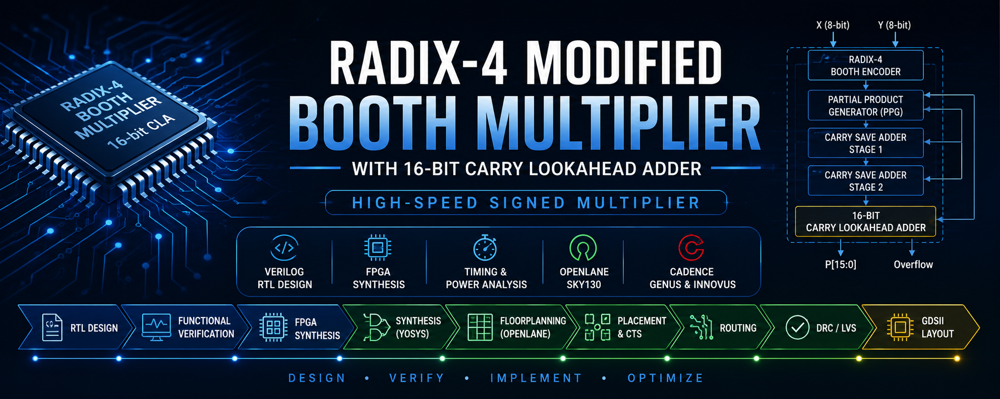

<div align="center">



# Radix-4 Modified Booth Multiplier with 16-bit Carry Lookahead Adder

### High-Speed Signed Multiplier • Verilog HDL • FPGA & ASIC Implementation


**RTL Design • Functional Verification • FPGA Synthesis • RTL → GDSII**

</div>

---

# 📖 Overview

This project implements an **8-bit signed Radix-4 Modified Booth Multiplier** integrated with a **16-bit Carry Lookahead Adder (CLA)** for high-speed signed multiplication.

The multiplier reduces the number of generated partial products using **Modified Booth Encoding**, compresses them through **Carry Save Adders (CSA)**, and performs the final addition using a **Carry Lookahead Adder (CLA)**.

The complete design was:

- Developed in **Verilog HDL**
- Functionally verified using **Vivado**
- Synthesized and analyzed on FPGA
- Implemented through the complete **RTL-to-GDSII** flow using **OpenLane (Sky130)**
- Re-implemented using **Cadence Genus & Innovus (45nm)**

---

# ✨ Project Highlights

- ✅ 8-bit Signed Radix-4 Booth Multiplier
- ✅ 16-bit Carry Lookahead Adder
- ✅ Modular RTL Design
- ✅ Comprehensive Functional Verification
- ✅ FPGA Synthesis & Timing Analysis
- ✅ Complete OpenLane RTL-to-GDSII Flow
- ✅ ASIC Implementation using Cadence Genus & Innovus

---

# 🏗️ Architecture

<p align="center">

</p>

The architecture consists of:

- Booth Encoder
- Partial Product Generator (PPG)
- Carry Save Adder Stage-I
- Carry Save Adder Stage-II
- 16-bit Carry Lookahead Adder

---

# 🧩 RTL Modules

| RTL Module | Description |
|------------|-------------|
| `booth_4.v` | Radix-4 Modified Booth Encoder |
| `ppg.v` | Partial Product Generator |
| `csa.v` | Carry Save Adder |
| `cla_16.v` | 16-bit Carry Lookahead Adder |
| `Booth_CLA_Top.v` | Top-Level Module |

---

# 🧪 Functional Verification

The RTL design was validated using a comprehensive Verilog testbench in **Vivado**, covering positive, negative, and boundary test cases.

### Sample Test Cases

| Multiplicand | Multiplier | Product |
|-------------:|-----------:|---------:|
| 5 | 3 | 15 |
| -5 | 3 | -15 |
| 127 | 127 | 16129 |
| -128 | -128 | 16384 |
| -128 | 127 | -16256 |

<p align="center">

</p>

---

# 📊 FPGA Implementation (Vivado)

## Resource Utilization

| Metric | Value |
|---------|------:|
| LUT Utilization | 93 LUTs (0.45%) |
| I/O Utilization | 31.13% |

<p align="center">

</p>

---

## Timing Performance

| Metric | Value |
|---------|------:|
| Worst Negative Slack | 6.075 ns |
| Worst Hold Slack | 1.375 ns |
| Critical Path Delay | 13.925 ns |

<p align="center">

</p>

---

## Power Analysis

| Metric | Value |
|---------|------:|
| Total On-Chip Power | 0.078 W |
| Dynamic Power | 0.008 W |
| Static Power | 0.070 W |

<p align="center">

</p>

---

# 🏭 ASIC Implementation (OpenLane - Sky130)

## New Reproducible OpenLane Implementation

A newer reproducible OpenLane implementation using the current OpenLane container environment and the **SKY130A** PDK (`sky130_fd_sc_hd`) was subsequently performed. The design was hardened under 40% and 70% core utilization targets with zero DRC/LVS violations, achieving post-route worst-path data arrival times of 6.76 ns (70% utilization) and 6.81 ns (40% utilization) under virtual-clock I/O timing constraints.

> [!TIP]
> Detailed implementation metrics, 40% vs. 70% comparative results, layout captures, and timing analyses are documented in [openlane/openlane_results.md](openlane/openlane_results.md).

---

## Previous OpenLane / VSD Environment Results (Historical)

> [!NOTE]
> The screenshots and metrics below represent an earlier historical implementation conducted in a predefined VSD/OpenLane environment.

### RTL → GDSII Flow (Historical VSD Run)

#### Floorplan

<p align="center">

</p>

---

#### Placement

<p align="center">

</p>

---

#### Routing

<p align="center">

</p>

---

#### Final GDSII Layout

<p align="center">

</p>

---

### Previous VSD Run Metrics

| Metric | Value |
|---------|------:|
| Standard Cells | 505 |
| Cell Area | 3968.81 μm² |
| Core Utilization | 31.49% |
| Wire Length | 12842 μm |
| Total Vias | 3553 |
| DRC Violations | 0 |

---

### Previous VSD Run Timing Summary

| Stage | Delay |
|--------|------:|
| Post-Synthesis | 12.84 ns |
| Post-Placement | 11.68 ns |
| Post-Routing | 11.96 ns |

---

# 🏭 ASIC Implementation (Cadence Genus & Innovus)

<p align="center">

</p>

## Results

| Metric | Value |
|---------|------:|
| Technology | 45 nm |
| Cell Count | 195 |
| Total Area | 1073.284 μm² |
| Critical Path Delay | 1.278 ns |
| Timing Slack | 8.722 ns |

---

# 📈 Performance Comparison

| Platform | Technology | Timing Result | Area / Resource |
|----------|------------|---------------|-----------------|
| Vivado | FPGA | 13.925 ns critical path | 93 LUTs |
| OpenLane (Clean SKY130A, 70%) | Sky130A | 6.76 ns post-route data arrival | 3971.31 μm² core area |
| OpenLane (VSD Historical) | Sky130 | 11.96 ns reported in previous VSD flow | 3968.81 μm² cell area |
| Cadence | 45 nm | 1.278 ns critical path | 374.49 μm² placement area |

> [!NOTE]
> These results come from different implementation flows, technologies, and area definitions, so the values should not be interpreted as a directly comparable benchmark.

---

# 📂 Repository Structure

```
.
├── rtl/              # Verilog RTL source files
├── testbench/        # Functional verification
├── docs/             # Historical VSD OpenLane, Vivado & Cadence images
├── docs_new/         # New OpenLane implementation screenshots
│   ├── floorplan.png
│   ├── placement.png
│   └── final_gds.png
├── openlane/         # OpenLane implementation documentation
│   └── openlane_results.md
├── reports/          # Vivado & OpenLane reports
└── README.md
```

---

# 🚀 Future Enhancements

- 16-bit and 32-bit Booth Multiplier
- Radix-8 Booth Encoding
- Wallace Tree Reduction
- Pipelined Architecture
- Low-Power Optimization
- Static Timing Optimization

---

# 🛠️ Tools & Technologies

- Verilog HDL
- Xilinx Vivado
- GTKWave
- Yosys
- OpenLane
- OpenROAD
- Magic
- Netgen
- Sky130 PDK
- Cadence Genus
- Cadence Innovus

---

# 📄 Project Report

A detailed project report describing the architecture, RTL implementation, FPGA synthesis, ASIC implementation, timing analysis, and experimental results is available below.

📘 **Report:** [Radix-4_Booth_Multiplier_CLA_Report.pdf](reports/Radix-4_Booth_Multiplier_CLA_Report.pdf)

