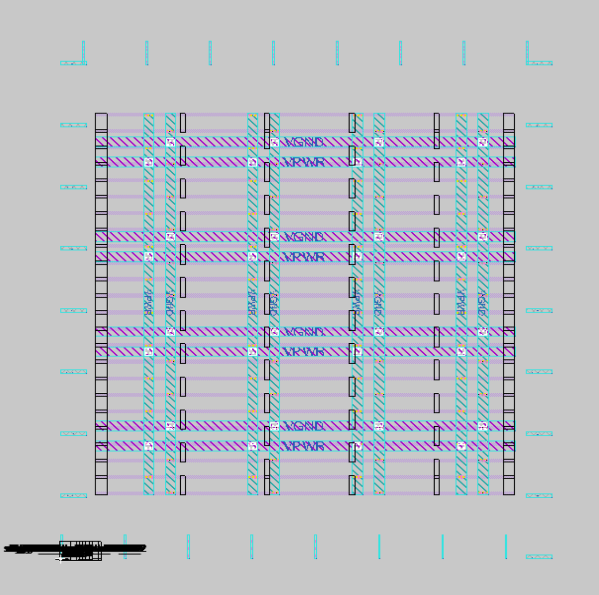
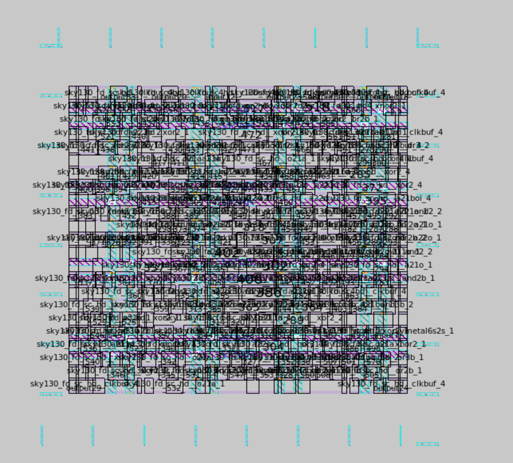
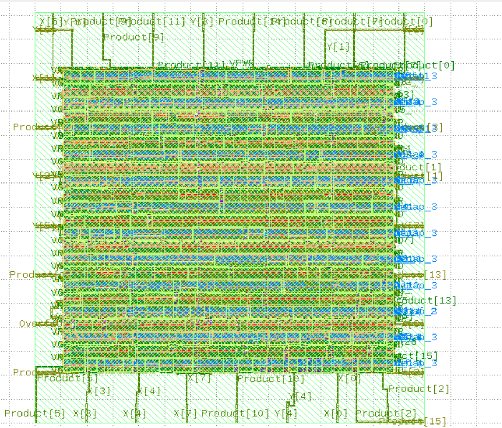

# 🚀 OpenLane ASIC Implementation Results

## 📖 Overview

This document details the clean, reproducible ASIC implementation of the **8-bit Signed Radix-4 Modified Booth Multiplier with 16-bit Carry Lookahead Adder (CLA)** using the OpenLane automated RTL-to-GDSII flow and the open-source **SKY130A** PDK (`sky130_fd_sc_hd`).

This implementation represents a newly validated run distinguished from earlier historical runs performed in a predefined VSD/OpenLane environment. The design was hardened under two core utilization targets (**40%** and **70%**) to analyze standard-cell placement density, wire length, via count, and post-route combinational path delays.

> [!NOTE]
> ### ⚡ Primary Implementation Highlights (70% Utilization Target)
> - **Core Area:** 3971.31 μm²
> - **Worst-path data arrival:** 6.76 ns
> - **Slack:** +0.99 ns
> - **DRC:** 0
> - **LVS:** 0

### 🧩 Design Specifications
- **Top-Level Module:** `Booth_CLA_Top`
- **RTL Source Files:**
  - `Booth_CLA_Top.v` (Top-level multiplier and adder integration)
  - `booth_4_encoder.v` (Radix-4 Booth recoding logic)
  - `ppg.v` (Partial product generator)
  - `csa.v` (Carry save adder tree)
  - `cla.v` (Lookahead carry generator logic)
  - `carry_look_ahead_adder.v` (16-bit carry lookahead adder)

---

## 🛠️ Technology & Flow

The design was hardened using the **SKY130A** process design kit and the high-density standard-cell library (`sky130_fd_sc_hd`). The automated RTL-to-GDSII physical design flow was executed through **OpenLane**, utilizing the following toolchain:

- **Synthesis:** Yosys & ABC
- **Floorplanning & PDN:** OpenROAD
- **Placement & Optimization:** OpenROAD
- **Routing:** OpenROAD (FastRoute global routing & TritonRoute detailed routing)
- **Parasitic Extraction (RCX):** OpenROAD
- **Static Timing Analysis (STA):** OpenROAD / OpenSTA
- **Physical Verification (DRC/LVS):** Magic (DRC) & Netgen (LVS)
- **Layout Inspection:** Magic & KLayout

```
RTL
  → Synthesis
  → Floorplan
  → Placement
  → Routing
  → Parasitic Extraction
  → Static Timing Analysis
  → DRC/LVS
  → GDSII
```

---

## 🏗️ Physical Implementation

### Floorplan

The core dimensions, aspect ratio, I/O pin placements, and power distribution network (PDN) straps were generated during the floorplan stage.

<p align="center">
  
</p>

---

### Placement

Global and detailed placement of standard cells was performed with cell density legalization across the core area.

<p align="center">
  
</p>

---

### Final GDSII Layout

The final GDSII stream was successfully generated by the OpenLane flow following detailed routing, antenna diode insertion, and physical verification, and inspected using layout viewers (Magic / KLayout).

<p align="center">
  
</p>

---

## 📊 Implementation Results

The table below summarizes the physical and electrical metrics for both the 40% and 70% core utilization runs:

| Metric | 40% Core Utilization | 70% Core Utilization |
|:-------------------------------|:--------------------:|:--------------------:|
| **Standard Cell Library**      | `sky130_fd_sc_hd`    | `sky130_fd_sc_hd`    |
| **Synthesized Cells**          | 295                  | 295                  |
| **Total Cells**                | 1032                 | 651                  |
| **Core Area**                  | 7098.06 μm²          | 3971.31 μm²          |
| **Die Area**                   | 10157.13 μm²         | 6418.56 μm²          |
| **Wire Length**                | 8386 μm              | 7592 μm              |
| **Total Vias**                 | 2500                 | 2591                 |
| **Worst Setup Slack**          | +0.94 ns             | +0.99 ns             |
| **Worst Hold Slack**           | +4.29 ns             | +4.30 ns             |
| **DRC Violations**             | 0                    | 0                    |
| **LVS Errors**                 | 0                    | 0                    |
| **Flow Status**                | Completed successfully | Completed successfully |

---

## ⏱️ Timing Analysis (Post-Route)

Post-route static timing analysis (STA) was performed following parasitic RC extraction. The critical path was evaluated from the multiplier inputs to the product outputs under virtual-clock I/O constraints.

### 70% Core Utilization Run
- **Startpoint:** `Y[0]`
- **Endpoint:** `Product[13]`
- **Data Arrival Time:** 6.76 ns
- **Required Time:** 7.75 ns
- **Slack:** +0.99 ns

### 40% Core Utilization Run
- **Startpoint:** `Y[0]`
- **Endpoint:** `Product[13]`
- **Data Arrival Time:** 6.81 ns
- **Required Time:** 7.75 ns
- **Slack:** +0.94 ns

### Virtual Clock / I/O Timing Assumption
Because the design is a combinational multiplier with no internal sequential registers, the OpenLane STA reports employ a virtual clock (`__VIRTUAL_CLK__`) to apply input arrival times and output required times for I/O boundary analysis. The reported data arrival times (6.76 ns and 6.81 ns) represent the total post-route combinational path propagation delay from input pins through the Booth encoder, partial product generator, carry save adder stages, and final carry lookahead adder to the product output pins.

---

## 🛡️ Physical Verification

Sign-off physical verification passed cleanly for both configurations:

- **DRC Violations:** 0 (Magic DRC clean)
- **LVS Errors:** 0 (Netgen LVS clean)
- **Flow Status:** Flow completed successfully without any DRC or LVS violations.

---

## 📝 Design & Architecture Notes

- **Combinational Nature:** This multiplier design is purely combinational and contains no sequential storage elements (flip-flops/registers) or physical clock ports.
- **Timing Interpretation:** The timing figures reported by STA represent pin-to-pin combinational propagation delay under virtual clock constraints and must **not** be interpreted as an intrinsic operating clock frequency.
